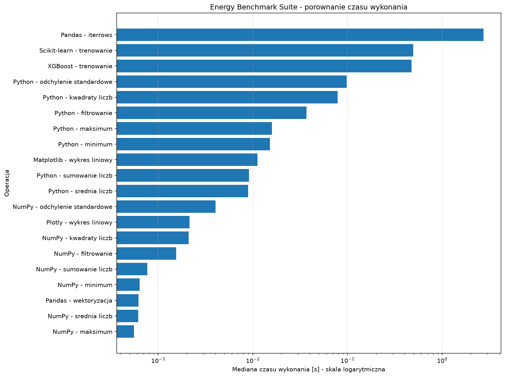
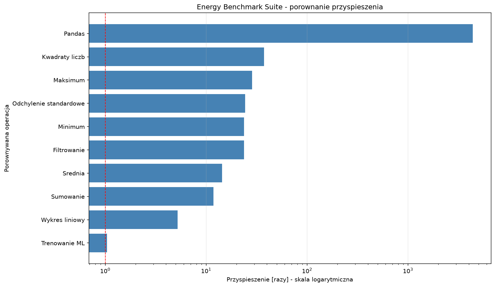

# Energy Benchmark Suite

## 1. Cel projektu

Celem projektu jest porównanie wydajności różnych
metod wykonywania operacji obliczeniowych w Pythonie.

Porównano:
- Python i NumPy
- Pandas iterrows() i wektoryzację
- Matplotlib i Plotly
- Scikit-learn i XGBoost

Badanie obejmuje czas wykonania, czas CPU oraz
zmianę pamięci RAM.

## 2. Metodologia

Przeprowadzono 10 porównań obejmujących 20 wariantów
operacji.

Każdy wariant wykonano pięciokrotnie.

Łącznie przeprowadzono 100 pomiarów.

Do porównania wydajności wykorzystano medianę
czasu wykonania.

Narzędzia pomiarowe:
- time.perf_counter() - czas wykonania
- psutil - czas CPU i zmiana pamięci RAM
- Pandas - analiza i zapis wyników
- Matplotlib - wizualizacja wyników

## 3. Ograniczenia pomiarów

Pomiary przeprowadzono w środowisku Ubuntu WSL2.

Nie uzyskano bezpośredniego dostępu do liczników
zużycia energii procesora.

Czas wykonania, czas CPU i zmiana pamięci RAM
nie są bezpośrednimi pomiarami energii elektrycznej.

Z tego powodu wyniki pozwalają porównywać wydajność
obliczeniową, ale nie pozwalają określić rzeczywistego
zużycia energii w dżulach ani watogodzinach.

Wyniki mogą zależeć od obciążenia systemu,
zarządzania pamięcią, rozgrzewki kodu oraz
dokładności mechanizmów pomiarowych.

## 4. Wyniki benchmarków

Poniższa tabela przedstawia współczynniki przyspieszenia
obliczone na podstawie median pięciu pomiarów.

| Operacja | Przyspieszenie |
|---|---:|
| Kwadraty liczb — NumPy vs Python | 37,51× |
| Pandas — wektoryzacja vs iterrows() | 4374,71× |
| Wykres liniowy — Plotly vs Matplotlib | 5,22× |
| Trenowanie ML — XGBoost vs Scikit-learn | 1,04× |
| Sumowanie — NumPy vs Python | 11,79× |
| Średnia — NumPy vs Python | 14,39× |
| Maksimum — NumPy vs Python | 28,48× |
| Minimum — NumPy vs Python | 23,77× |
| Odchylenie standardowe — NumPy vs Python | 24,26× |
| Filtrowanie — NumPy vs Python | 23,75× |

Współczynnik większy od 1 oznacza, że rozwiązanie
wymienione jako pierwsze było szybsze.

Największe przyspieszenie zaobserwowano podczas
wektoryzacji operacji Pandas.

Wyniki dotyczą konkretnych implementacji i danych
testowych. Nie oznaczają, że jedna biblioteka
jest zawsze szybsza od drugiej.

## 5. Wizualizacja wyników

### 5.1. Porównanie czasu wykonania

Poniższy wykres przedstawia medianę czasu wykonania
wszystkich 20 wariantów operacji.

Zastosowano skalę logarytmiczną ze względu na
duże różnice między czasami wykonania.

### 5.2. Porównanie przyspieszenia

Poniższy wykres przedstawia współczynniki
przyspieszenia dla 10 porównywanych par operacji.

Wartość 1 oznacza jednakowy czas wykonania.
Wartości większe od 1 oznaczają przewagę
drugiego wariantu w danej parze.

## 6. Interpretacja wyników

### 6.1. Python i NumPy

NumPy osiągnął krótsze czasy wykonania we wszystkich
testowanych operacjach numerycznych.

Największe przyspieszenie uzyskano podczas
obliczania kwadratów liczb: 37,51 razy.

Wyniki wskazują na korzyści wynikające
z wykorzystania operacji wektorowych.

### 6.2. Pandas

Wektoryzacja Pandas była 4374,71 razy szybsza
od iterrows() w testowanym zadaniu.

Pokazuje to, jak duże znaczenie dla wydajności
może mieć unikanie iteracji po pojedynczych wierszach.

### 6.3. Matplotlib i Plotly

W badanym przypadku tworzenie obiektu wykresu
w Plotly było 5,22 razy szybsze niż w Matplotlib.

Nie porównywano jednak pełnego renderowania,
wyświetlania ani eksportowania wykresów.

### 6.4. Scikit-learn i XGBoost

Czasy trenowania modeli były zbliżone.

W ostatnim pomiarze XGBoost osiągnął czas
nieznacznie krótszy niż w Scikit-learn
(przyspieszenie 1,04×).

Porównano jednak różne implementacje algorytmów,
dlatego nie można na tej podstawie stwierdzić,
że jedna biblioteka jest ogólnie wydajniejsza.

Nie oceniano również jakości predykcji modeli.

## 7. Wnioski końcowe

1. Wektoryzacja może znacząco przyspieszyć
   przetwarzanie danych.

2. NumPy osiągnął lepszą wydajność niż zastosowane
   implementacje operacji w Pythonie.

3. Unikanie iterrows() może przynieść bardzo duże
   korzyści wydajnościowe w Pandas.

4. Wielokrotne pomiary i wykorzystanie mediany
   pomagają ograniczać wpływ pojedynczych
   nietypowych wyników.

5. Krótszy czas wykonania nie oznacza automatycznie
   proporcjonalnie mniejszego zużycia energii.

6. Do rzetelnej analizy energetycznej konieczne
   byłyby dodatkowe pomiary poboru energii,
   np. za pomocą liczników sprzętowych.

## 8. Pliki projektu

- zadanie16.py - kod benchmarków
- energy_benchmark_results.csv - 100 pomiarów
- energy_benchmark_summary.csv - mediany 20 wariantów
- energy_benchmark_speedup.csv - 10 współczynników
- energy_benchmark_times.png - wykres czasów
- energy_benchmark_speedup.png - wykres przyspieszenia
- energy_benchmark_report.md - raport końcowy
